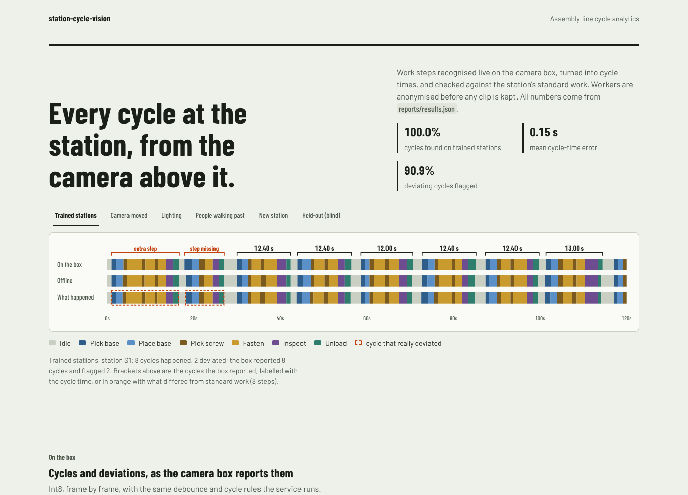

# station-cycle-vision

A camera above a manual assembly station watches the work. This project turns that video into the
numbers a production engineer needs, live on the camera box:
- which work step is happening;
- when each cycle starts and ends, and how long it took;
- whether the cycle followed the station's standard work (a step missing, an extra step, steps out of order).

Workers are anonymised before any clip is kept. The video never leaves the box.

**Models.**
- A frame encoder and a causal temporal convolutional network (TCN) that runs one frame at a time.
- An offline transformer for comparison.
- A small detector for hands, the tool and people; a hand tracker; and an anonymiser.

**Delivery.**
- Trained and tracked with MLflow, with a data-parallel training path.
- Exported to ONNX. The image encoder is quantised to int8.
- Served by a FastAPI edge service that contains no PyTorch.
- Deployed to Kubernetes, with CI that streams a recording through the cluster.

The stations and their video are simulated ([ADR 1](docs/adr/0001-simulated-stations.md)), so every
shift is a dial and the truth is exact.



## What it measured

All numbers are from the committed full run (`reports/results.json`; the narrative is in
`docs/REPORT.md`):
- **Training data:** 32 labelled two-minute recordings from 4 stations, 19,200 frames at 5 fps.
- **Tests:** 8 recordings per shift, 3 from a new station, and 4 from a held-out station that was
  written blind (by someone who never saw the code).
- "Live" means what the camera box reports: the int8 encoder, the streaming TCN, and the same
  smoothing and cycle rules the service runs.

| | Result |
|---|---|
| **Cycles (trained stations, live)** | 100% of cycles found. Mean cycle-time error 0.15 s. 10 of 11 deviating cycles flagged, at 90.9% precision. Frame accuracy 94.2%, edit score 95.8. |
| **Camera moved 25°, zoom and tilt changed** | With camera and light augmentation: 93.0% frame accuracy, 100% of cycles found. Without augmentation the same model drops to 68.4% and finds 71.7% of cycles. |
| **People walking past, dropped frames** | 98.2% of cycles found, cycle-time error 0.41 s. Deviation precision falls to 40%: people walking through the view create false "extra step" flags. |
| **Live against offline** | The causal TCN (edit 95.7, F1@50 97.4) beats the offline bidirectional transformer (90.4 and 94.8) on segment quality on trained stations; the transformer has slightly higher frame accuracy (94.8% vs 94.2%). Waiting for the whole recording buys nothing here. |
| **New station** | Out of the box: 66% frame accuracy, 12.5% of cycles found. After fine-tuning the temporal model on **one** labelled two-minute recording: 88.7% and 87.5%. |
| **Blind held-out station** | First run, recorded once and never rewritten: the causal TCN reaches 75.6% frame accuracy and finds 54.5% of cycles. Different layout, product and camera; it needs its own onboarding recording. |
| **Anonymisation** | 0.28% of person pixels left visible on trained stations and 4.6% with people walking past, at the cost of pixelating 4–13% of the bench. |
| **Edge** | 0.61 ms per frame on one core (int8 encoder plus streaming TCN). At 5 fps that is about 330 cameras per core at this resolution. int8 and float give the same frame label on 99.8% of frames. |

### What is weak

- **Hand tracking is the weakest part.** Hands are found 80% of the time at 84% precision, but
  identities switch about 55 times a minute (IDF1 0.08). The two hands look identical, and they meet
  at the fixture. The fix is an appearance or arm-side cue in the tracker; it is not built yet. Cycle
  times and deviations do not depend on it.
- **People walking past cause false deviation flags.** They are also where the anonymiser leaks most.
- **Frames are 64 × 64 and rendered.** The latency numbers compare implementations; they are not a
  camera-box benchmark.

## How it is built

```
sim/          stations (layout, standard work), worker schedules with deviations, a renderer:
              bench, parts, tool, arms and hands, passers-by -> camera homography, light, noise, drops
temporal/     FrameEncoder (3 stacked frames -> 128-d), FrameOnly, CausalTCN (MS-TCN, 2 stages,
              receptive field 511 frames), OfflineTransformer; MS-TCN smoothing loss
perception/   Detector (hand and tool heatmaps at stride 4, person mask), Kalman+Hungarian tracker,
              anonymiser (threshold low, mask dilated, pixelated)
process/      segments -> cycles -> Damerau-Levenshtein alignment with standard work
              (missing / extra / order); live: causal debounce + incremental cycle state machine
train/        encoder with camera/light augmentation, temporal models, detector; DDP (gloo/nccl)
edge/         ONNX export, static int8 (QDQ, per channel), TCN as a one-frame step with explicit state
service/      FastAPI on the box: frames in, events out; SQLite events, anonymised clips, Prometheus
evaluate/     action-segmentation metrics (accuracy, edit, F1@10/25/50), cycle and deviation metrics,
              CLEAR MOT and IDF1, leak rate; experiment, report, release gate
web/          dashboard: React 19, Vite, Motion; reads reports/results.json, computes nothing
deploy/       Dockerfile.edge (no PyTorch), Dockerfile.train, kustomize (edge Deployment, PVC,
              NetworkPolicy with no egress, restricted pods), training Job
```

The equivalences are tested, not assumed:
- streaming TCN = offline TCN (< 1e-5);
- ONNX edge path = PyTorch (< 1e-3);
- the service emits exactly what the reference live process emits, whatever the request chunking;
- two DDP ranks take the same gradient step as one process.

Decisions are in `docs/adr/`.

## Run it

```bash
pip install torch --index-url https://download.pytorch.org/whl/cpu
pip install -e ".[train,service,dev]" sqlalchemy alembic
scv all --profile quick          # render, train, evaluate, export, report, gate: about a minute
scv all                          # the committed run: about 20 minutes on two cores
pytest -m "not slow"             # about two minutes
scv serve                        # the edge service on :8080, serving the ONNX models in models/
python scripts/smoke.py http://localhost:8080   # stream a rendered recording, check the cycles
cd web && npm ci && npm run dev  # the dashboard
```

| Endpoint | |
|---|---|
| `POST /v1/stations/{station}/frames` | Raw uint8 frames (N × 64 × 64 × 3). Returns step and cycle events. |
| `GET /v1/stations/{station}/cycles` | Completed cycles: cycle time, steps, deviations, clip id. |
| `GET /v1/stations/{station}/events?after_id=` | Every committed event, oldest first. |
| `GET /v1/clips/{id}` | An anonymised clip kept for a deviating cycle. |
| `GET /healthz` `/readyz` `/metrics` | Liveness, models loaded, Prometheus. |

CI (`.github/workflows/ci.yml`):
- **python:** ruff, the unit tests and the release gate on the committed run;
- **pipeline:** the quick profile end to end;
- **edge image:** built and checked to have no PyTorch, deployed to a kind cluster, then a two-minute recording streamed through the cluster;
- **web:** the dashboard, with Biome, Vitest, the build, and Playwright with axe on desktop and phone.

## Limits

- **Rendered, not filmed.** The accuracy figures do not transfer to a real line; the method, the
  checks and the plumbing do.
- **No GPU here.** There is no TensorRT path, and the distributed path is tested on CPU with gloo.
  The committed run trains in one process.
- **Privacy is engineering only.** The anonymisation is a technical measure. It is not a legal
  assessment; a real deployment needs a DPIA and the works council
  ([ADR 4](docs/adr/0004-anonymisation.md)).
